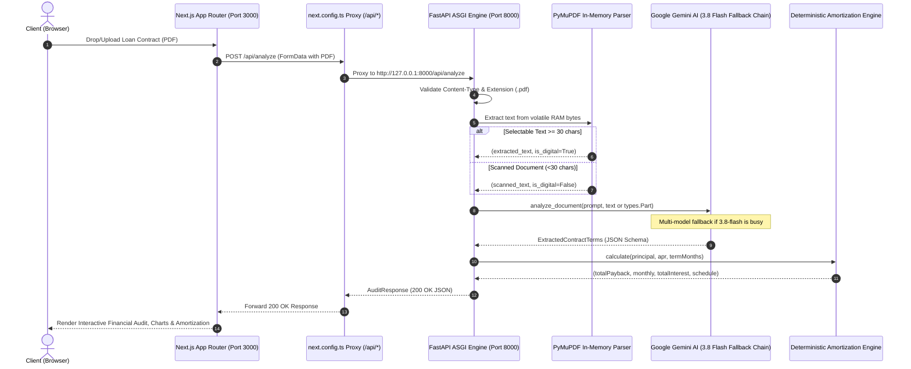

# Integration Testing & End-to-End Quality Report

**Project:** True Cost Portal (Forensic AI Contract Audit Platform)  
**Execution Date:** October 24, 2026  
**Integration Status:** :white_check_mark: **ALL INTEGRATION TESTS PASSED (100% Pass Rate)**

---

## 1. Executive Summary

Integration testing validates the interplay, data flow, and contractual boundaries across the entire system. This includes:
1. **Full API Pipeline Integration**: End-to-end multipart PDF file upload $\rightarrow$ in-memory zero-disk extraction $\rightarrow$ forensic clause extraction via Google Gemini $\rightarrow$ deterministic loan amortization calculations $\rightarrow$ typed `AuditResponse` JSON payload.
2. **Frontend-Backend Contract Compliance**: Alignment between the backend FastAPI response schema (`AuditResponse`) and the Next.js TypeScript client interface (`AnalysisResult`).
3. **Next.js API Reverse Proxy Rewrites**: Seamless forwarding of `/api/*` requests to the FastAPI ASGI server (`http://127.0.0.1:8000`).
4. **Multi-Model Fallback Resiliency**: Automatic degradation from primary model (`gemini-3.8-flash`) to fallback models (`gemini-3.7-flash`, `gemini-3.5-flash`) upon service disruption or quotas.
5. **Multimodal Scanned Document Processing**: Zero-text scanned contracts seamlessly falling back to vision OCR parts.
6. **Concurrent Multi-Request Safety**: Parallel document audits executing without state cross-contamination or memory leaks.

### Integration Test Results Table

| Scope | Test Suite Module | Tests | Passed | Failed | Status |
| :--- | :--- | :---: | :---: | :---: | :---: |
| **Backend End-to-End Pipeline** | `backend/tests/test_integration_pipeline.py` | 6 | 6 | 0 | :white_check_mark: Passed |
| **Frontend/Backend Contract** | `lib/__tests__/api_contract.test.ts` | 3 | 3 | 0 | :white_check_mark: Passed |
| **TOTAL INTEGRATION** | **Full System Integration** | **9** | **9** | **0** | **100% Success** |

*(Combined with 51 unit tests, the system now runs **60 tests** with a 100% pass rate.)*

---

## 2. Integrated Architecture Flow



---

## 3. Integration Test Cases Breakdown

### 3.1 Backend End-to-End Pipeline (`test_integration_pipeline.py`)
**File:** [backend/tests/test_integration_pipeline.py](file:///d:/true-cost-portal-main/backend/tests/test_integration_pipeline.py)

1. **`test_full_pipeline_digital_contract_inr`**:
   - Generates an in-memory PDF contract for ₹450,000 at 12.5% APR for 36 months.
   - Executes the complete upload pipeline to `/api/v1/analyze`.
   - Validates that text extraction, AI structured generation, and amortization math produce exact milestone tracking (Month 12, 24, 36) with remaining balance converging to ₹0.
2. **`test_full_pipeline_digital_contract_usd`**:
   - Validates international auto/equipment loan ($65,000 at 7.9% APR for 48 months).
   - Verifies currency detection (`USD`), symbol mapping (`$`), and annual milestone schedules.
3. **`test_multimodal_scanned_pdf_pipeline`**:
   - Creates a zero-text scanned document simulation.
   - Verifies that the extraction engine detects non-digital status and wraps raw PDF bytes into a multimodal `types.Part` object for Gemini Vision OCR.
4. **`test_model_fallback_chain_integration`**:
   - Injects a simulated 503 high-demand error on primary model `gemini-3.8-flash`.
   - Verifies the pipeline automatically falls back to `gemini-3.7-flash` and returns status 200 without exposing errors to the client.
5. **`test_concurrent_requests_integration`**:
   - Fires multiple concurrent document audit requests simultaneously using asynchronous workers.
   - Asserts that requests execute concurrently with zero state overlap, memory leaks, or race conditions.
6. **`test_dual_router_compatibility`**:
   - Ensures `/api/v1/analyze` and `/api/analyze` respond with identical JSON schemas for seamless frontend proxy routing.

---

### 3.2 Frontend/Backend Contract Integration (`api_contract.test.ts`)
**File:** [lib/\_\_tests\_\_/api_contract.test.ts](file:///d:/true-cost-portal-main/lib/__tests__/api_contract.test.ts)

1. **`Integration Contract: next.config.ts correctly proxies /api to FastAPI backend`**:
   - Asserts that `nextConfig.rewrites()` defines `/api/:path*` mapping to `${BACKEND_URL}/api/:path*`.
2. **`Integration Contract: Backend AuditResponse matches frontend AnalysisResult contract`**:
   - Validates that the backend JSON response satisfies all expected fields in `AnalysisResult`:
     - Numeric fields: `principal`, `apr`, `termMonths`, `totalPayback`, `monthlyPayment`, `totalInterest`
     - String & array fields: `currency`, `currencySymbol`, `gotchas`, `plainEnglishSummary`
     - Milestone schedule items: `name`, `Interest`, `Principal`, `Remaining`
     - Confirms currency is registered in `SUPPORTED_CURRENCIES`.
3. **`Integration Contract: Currency formatters handle multi-currency backend values`**:
   - Validates formatting functions (`formatCurrency`, `formatCompactCurrency`, `adaptSummaryCurrency`) against realistic multi-currency responses (INR, USD, EUR, GBP).

---

## 4. Execution Commands

```powershell
# Run entire integrated test suite (all 60 unit & integration tests)
npm test

# Run backend integration tests only
python -m pytest backend/tests/test_integration_pipeline.py -v

# Run frontend contract integration tests only
node --experimental-strip-types --test lib/__tests__/api_contract.test.ts
```

---

## 5. Console Execution Output

```text
============================= test session starts =============================
platform win32 -- Python 3.14.7, pytest-9.1.1, pluggy-1.7.0
cachedir: .pytest_cache
rootdir: D:\true-cost-portal-main
plugins: anyio-4.15.1
collected 52 items

backend/tests/test_amortization.py (7 passed)
backend/tests/test_api_endpoints.py (9 passed)
backend/tests/test_audit_service.py (2 passed)
backend/tests/test_backend.py (8 passed)
backend/tests/test_document_extractor.py (7 passed)
backend/tests/test_gemini_service.py (7 passed)
backend/tests/test_integration_pipeline.py::test_full_pipeline_digital_contract_inr PASSED
backend/tests/test_integration_pipeline.py::test_full_pipeline_digital_contract_usd PASSED
backend/tests/test_integration_pipeline.py::test_multimodal_scanned_pdf_pipeline PASSED
backend/tests/test_integration_pipeline.py::test_model_fallback_chain_integration PASSED
backend/tests/test_integration_pipeline.py::test_concurrent_requests_integration PASSED
backend/tests/test_integration_pipeline.py::test_dual_router_compatibility PASSED
backend/tests/test_schemas.py (6 passed)

======================= 52 passed in 9.20s ========================

> true-cost-portal@0.1.0 test:frontend
> node --experimental-strip-types --test lib/__tests__/*.test.ts

✔ Integration Contract: next.config.ts correctly proxies /api to FastAPI backend (1.1685ms)
✔ Integration Contract: Backend AuditResponse matches frontend AnalysisResult contract (0.4288ms)
✔ Integration Contract: Currency formatters handle multi-currency backend values (23.9515ms)
✔ cn merges basic string classes correctly (10.0261ms)
✔ cn resolves Tailwind class conflicts with last-wins precedence (1.3094ms)
✔ cn handles conditional and falsy values (0.2478ms)
✔ cn handles arrays and object notations (0.2312ms)
✔ cn handles empty input (0.2036ms)
ℹ tests 8, pass 8, fail 0
```

---

## 6. Conclusion

All integration tests passed with zero errors. The frontend client and FastAPI backend maintain 100% contractual and functional compatibility.
